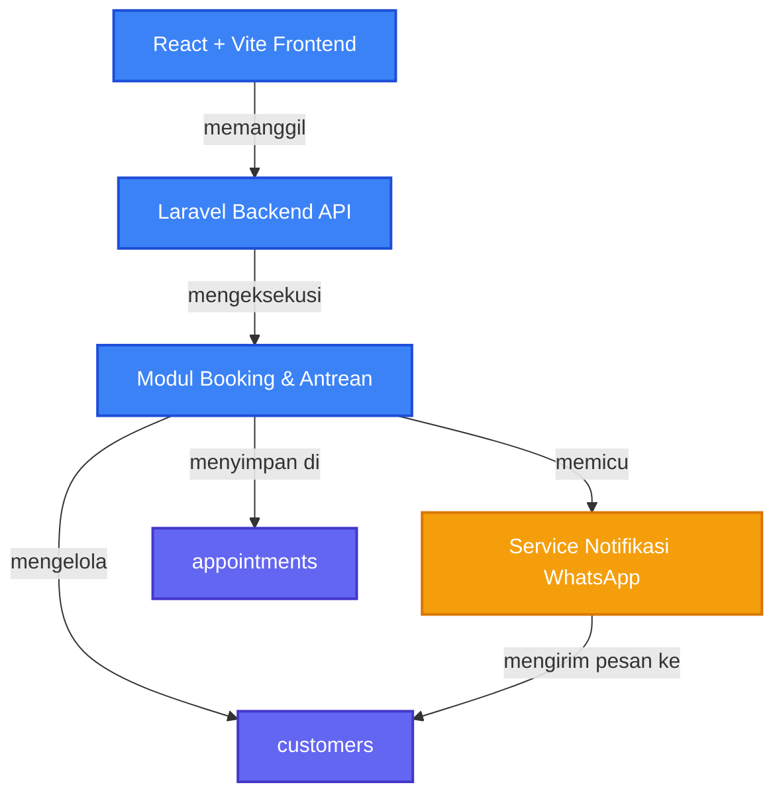

# Peta Fitur & Arsitektur: Web booking barber & antrean pelanggan dengan notifikasi Wha

## Diagram Alur Arsitektur (Mermaid)

## Daftar Modul & Entitas
- **React + Vite Frontend** (Modul)
- **Laravel Backend API** (Modul)
- **Modul Booking & Antrean** (Modul)
- **Service Notifikasi WhatsApp** (Integrasi Eksternal)
- **appointments** (Basis Data / Entitas)
- **customers** (Basis Data / Entitas)
